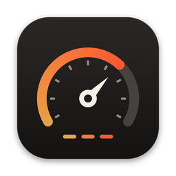
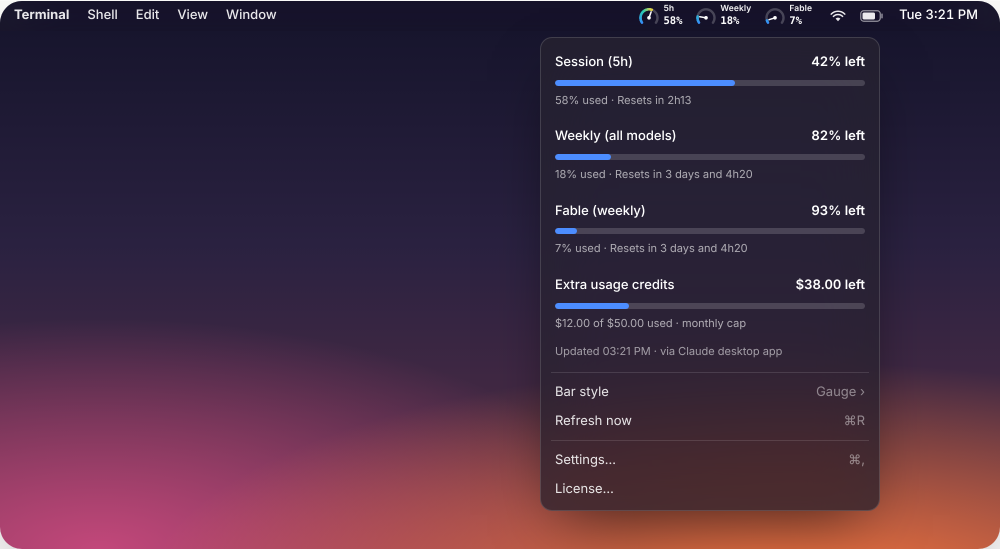
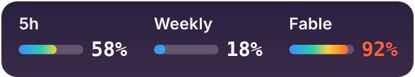
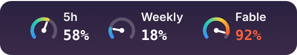
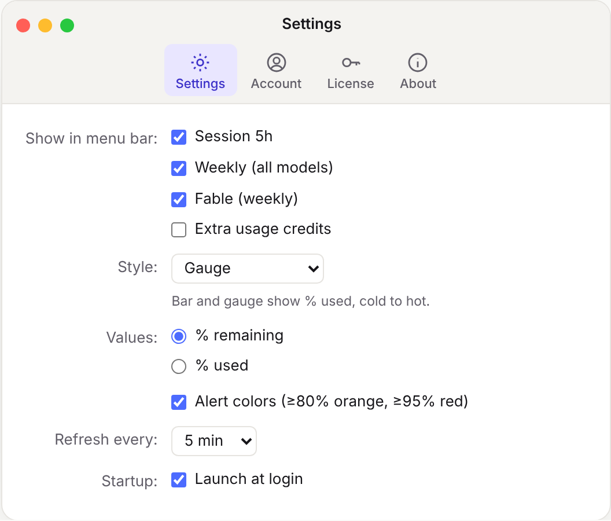
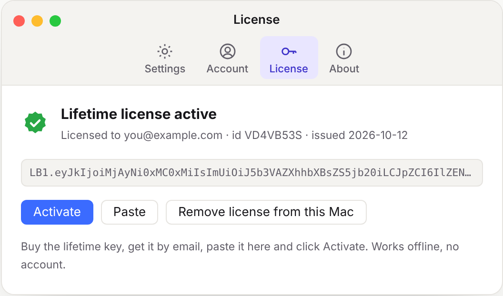

<p align="center">
  
</p>

<h1 align="center">Limitbar</h1>

<p align="center">
  <b>Seus limites do Claude, a um olhar de distância — e se você está no plano certo.</b><br>
  Sessão 5h · Weekly · Fable · créditos extras — direto na barra de menu do macOS.
</p>

<p align="center">
  <a href="https://github.com/andrecamellini01-ai/BigHeadStudios.Limitbar-releases/raw/main/Limitbar.dmg"></a>
  <a href="#planos"></a>
</p>

<p align="center">
  
  
  
  
  
  
</p>

<p align="center">
  <a href="https://github.com/andrecamellini01-ai/BigHeadStudios.Limitbar-releases/tree/main/versions"><b>Todas as versões →</b></a>
  &nbsp;·&nbsp;
  <a href="#planos"><b>Comparar planos →</b></a>
  &nbsp;·&nbsp;
  <a href="#estou-no-plano-certo-do-claude"><b>Advisor de plano →</b></a>
</p>

<p align="center">
  
</p>

---

## Pare de abrir Configurações › Uso no meio do trabalho

O Limitbar mora na barra de menu e mostra quanto resta de cada limite do Claude, o tempo todo. Passe o mouse para ver quando reseta. Quando um limite chega a **80%** ele fica laranja; em **95%**, vermelho. Você vê o aperto chegando antes de ser cortado no meio de uma tarefa.

Isso é o **Free** — grátis, para sempre. O **Lite** avisa e lembra. O **Pro** responde as perguntas que sobram:

| Pergunta | Quem responde |
|---|---|
| Quanto sobra agora e quando reseta? | **Free** — a barra |
| Vai acabar antes do reset? Me avise antes de travar. | **Lite** — projeção, alertas, histórico |
| **Estou no plano certo do Claude?** | **Pro** — Advisor de plano |
| Quando eu mais gasto? Como foi minha semana? | **Pro** — gráficos, mapa de calor, resumo semanal |
| Quanto vou gastar **em dinheiro** de créditos extras este mês? | **Pro** — orçamento de créditos |
| E minha conta do trabalho? | **Pro** — várias contas |

## Estou no plano certo do Claude?

O **Advisor de plano** (Pro) cruza as últimas **8 semanas** do seu histórico com o plano que a sua conta tem (Pro, Max 5x, Max 20x…) e com os preços de cada plano, e diz em uma frase:

> Nas últimas 8 semanas você travou 5 vez(es) e gastou US$ 110,00 em créditos — **Max 5x (US$ 100,00/mês) pode sair até US$ 30,00 mais barato por mês que Pro + créditos.**

> Pico de 18% em 8 semanas — no Max 5x seria ~72%. **Dá para descer de plano e economizar US$ 100,00 por mês.**

> Seu plano está no ponto: pico de 71%, 0 travada(s) em 8 semanas.

O que entra na conta:

- **Semanas e sessões que travaram** (≥ 95%) e **horas travado** em 100%.
- **Pico** de cada semana e de cada sessão, **escalado** para os outros planos (Max 5x = 5× o Pro, Max 20x = 20×): o seu pico de 41% no Max 5x seria mais de 200% no Pro.
- **Créditos extras por mês.** Se você paga créditos todo mês, o plano de cima pode sair mais barato do que o seu + créditos — e o Advisor faz essa conta em dólar. Créditos em outra moeda: ele compara sem converter.
- **Descer de plano** só é sugerido com pelo menos 2 semanas de histórico, sem créditos extras e com folga (os picos escalados ficam abaixo de 80% na semana e 90% na sessão).

Precisa de **7 dias** de histórico (em pelo menos 5 dias diferentes) para dar um veredito; antes disso, mostra o que já tem. Conta **Team/Enterprise** (plano gerenciado pela organização): só os números, para você levar para quem administra. Aparece na aba **Insights**, numa linha do menu e no resumo semanal.

## Três jeitos de ler

| Texto | Barrinha | Velocímetro |
|:---:|:---:|:---:|
|  |  |  |
| Rótulo pequeno, número grande. Mostra o que **sobra**, o que já foi **usado** ou a **projeção** (Pro). | Barra fria → quente com o % na ponta. Azul quando está tranquilo, vermelha perto do teto. | Mostrador de 250° com ponteiro, de 0 a 100% usado. |

Troque a qualquer momento pelo menu ou em Configurações.

## O que aparece na barra

| Item | O que é | No hover |
|---|---|---|
| **5h** | Sessão de 5 horas, que começa na sua primeira mensagem | `Reseta em 2h13` |
| **Weekly** | Teto semanal de todos os modelos — Claude, Claude Code e app desktop | `Reseta em 3 dias e 4h20` |
| **Fable** | Teto semanal do Fable, e de outros modelos que o seu plano tiver | `Reseta em 3 dias e 4h20` |
| **Créditos** | Uso extra pago, contra o teto mensal | `US$ 12,00 de US$ 50,00` |

Mostre um, dois ou todos (menu › **Mostrar na barra**). **⌘T** alterna o valor: **restante → usado → projeção** (a projeção é Pro). **⌘ + arrastar** reordena. **Clique direito** abre o status do Claude.

## Status do Claude

Uma bolinha no canto do item mostra a saúde do Claude em tempo real: **verde** quando está tudo no ar, **amarela/laranja** em degradação e **vermelha** em queda. **Clique direito** abre o painel de status — visão geral, cada serviço (Console, API, Code, Cowork e os demais) com seu estado e o histórico recente de incidentes, além do link para o `status.anthropic.com`.

Lê o status público da Anthropic, sem credencial. Está no **Free**. Dá para desligar em Configurações.

## Projeção de consumo (Lite)

Não só quanto já foi — **quando vai acabar**. Cada limite mostra para onde o seu ritmo está levando:

- **“Neste ritmo (12%/h): esgota em 1h20 (15:40)”** — em laranja quando acaba antes do reset;
- **“Sobram ~38% no reset”** — quando dá folga.

Aparece no menu, na dica do item da barra e nas notificações. Funciona já nos primeiros minutos da sessão e fica mais esperta com o histórico (pesa mais o ritmo da última hora na sessão e das últimas 24 h na semana).

**Na barra (Pro):** o 3º modo do ⌘T troca o número pela projeção — **`5h · ETA 1h20`** quando vai esgotar antes do reset, **`5h · sobra 38%`** quando dá folga.

## Alertas (Lite)

Uma notificação do macOS quando um limite passa do **aviso** (80%), do **crítico** (95%) e quando **esgota** — uma vez por subida, sem repetir enquanto o uso oscila perto do limiar.

- **Aviso antecipado:** “Sessão de 5h vai esgotar antes do reset” — antes de bater no limite, pela projeção.
- **Aviso de reset:** passou do crítico? O Limitbar avisa quando o limite renovar.
- **Silenciar** pela notificação (1 h ou até o reset) ou pelo menu (30 min, 1 hora, até amanhã).
- **Som** à sua escolha (o padrão segue o modo Foco), vibração do trackpad (experimental) e limiares ajustáveis.

## Histórico (Lite) e gráficos (Pro)

Cada leitura fica guardada **no seu Mac** por 90 dias. Na aba **Histórico**, escolha a métrica e o período (7, 30 ou 90 dias) e veja o **pico**, a **média**, **quantas vezes passou de 95%** e o **tempo que ficou travado** em 100%. **Exportar CSV** leva tudo para uma planilha. Isso é **Lite**.

Com o **Pro**:

- **Sparkline** em cada limite, direto no menu — as últimas horas num relance.
- **Gráfico do período** na aba Histórico, com as linhas do aviso e do crítico.
- **Mapa de calor hora × dia** na aba Insights: quanto do limite você consome em cada hora de cada dia da semana, em média. Descubra que você estoura sempre na terça às 15h.

## Orçamento de créditos extras (Pro)

Créditos extras são dinheiro, então o alerta também é em dinheiro. Defina um **teto mensal seu** (ex.: US$ 30, abaixo do limite da conta) em **Alertas › Orçamento** e o Limitbar:

- **projeta o gasto até o fim do ciclo** com o mesmo motor da projeção de consumo (ritmo do ciclo + dos últimos 3 dias): *“Neste ritmo: US$ 41,20 no fim do mês (US$ 11,20 acima do orçamento) · estoura em 24/10.”*
- avisa em **80%**, **95%** e **100%** do orçamento, e **antes**, quando a projeção passa do teto: *“Créditos extras vai estourar o orçamento este mês.”*
- acha o ciclo sozinho: quando os créditos zeram (cobrança nova), o ciclo recomeça dali; no 1º dia, espera ter dados antes de projetar.

Cada conta tem o seu orçamento.

## Várias contas (Pro)

Pessoal + trabalho (Team/Enterprise), ou duas pessoais: cada conta com os seus limites, histórico, alertas, orçamento e Advisor.

- **Lado a lado** na barra, com o nome curto na frente (`Trab 5h 62%`), ou **alternando** uma de cada vez (menu, ou `limitbar://account/next`).
- Origem de cada conta: o **login do Claude Code**, a **sessão do app Claude** ou uma **sessionKey** colada (fica no Keychain). Login do Claude Code e sessão do app Claude são um por Mac; sessionKey, quantas quiser.
- Aba **Contas**: adicione, renomeie, escolha o rótulo da barra (até 5 letras) ou remova.

## Resumo semanal (Pro)

Uma notificação **domingo à noite** (20h) ou **segunda cedo** (8h), você escolhe: consumo da semana, **pico**, **horas travado**, **tendência** contra a semana anterior (↑/↓), créditos gastos e uma linha do Advisor. Mac dormindo na hora? Chega quando ele acordar (até 36 h depois). Também dá para mandar agora pela aba Insights.

## Modo foco (Pro)

A barra **some** enquanto está tudo tranquilo — fica só um ícone discreto — e **volta sozinha** quando um limite passa do aviso (80%) ou quando o aviso antecipado diz que vai esgotar antes do reset. Liga pelo menu, em Configurações ou com `limitbar://focus`.

## Integrações (Pro)

Os números do Limitbar fora da barra. Nada disso fala com a Anthropic nem expõe credencial: o app lê o uso como sempre e só repassa números.

- **Atalhos e AppleScript** — *“quanto sobra da sessão?”*:
  ```applescript
  tell application "Limitbar" to get session remaining
  ```
  Também: `weekly remaining`, `session reset minutes`, `summary`, `current json`, `plan name` e o comando `refresh usage`.
- **`limitbar://`** — `refresh`, `toggle`, `value/forecast`, `focus/on`, `snooze?minutes=30`, `resume`, `account/next`, `copy`, `open/insights`… Funciona no Atalhos (“Abrir URL”), Raycast, Alfred e no Terminal (`open limitbar://refresh`).
- **Raycast** — extensão com a lista dos limites por conta (projeção, reset, créditos) e ações Atualizar, Abrir Insights, Modo foco e Silenciar 1 h.
- **`current.json`** — `~/Library/Application Support/Limitbar/current.json`, reescrito a cada leitura, para scripts, SketchyBar e Übersicht:
  ```bash
  jq -r '.accounts[0].metrics[] | select(.key=="session") | "\(.remaining)% · reseta em \(.resetsInMinutes) min"' \
    ~/Library/Application\ Support/Limitbar/current.json
  ```

## Tudo numa janelinha

<p align="center">
  
  &nbsp;
  
</p>

- **Configurações** — quais limites mostrar, estilo, valor na barra (restante · usado · projeção), modo foco, integrações, intervalo de atualização, abrir no login.
- **Alertas** — notificações, aviso antecipado, aviso de reset, som, limiares e orçamento de créditos.
- **Contas** — a conta principal (e-mail, plano do Claude e de onde veio a leitura, com um terminalzinho que registra cada atualização) e as contas extras.
- **Histórico** — pico, média, vezes acima de 95%, tempo travado, gráfico e CSV.
- **Insights** — Advisor de plano, mapa de calor hora × dia e resumo semanal.
- **Licença** — o seu plano do Limitbar (Free · Lite · Pro), a key e os Macs. Cole a key e pronto: sem conta.
- **Sobre** — versão, procurar atualizações e links.
- **Planos** (menu › Planos e upgrade) — os três planos lado a lado, o que você tem e os botões de compra.

---

## Planos

Três planos: **Free**, **Lite** e **Pro**. A key é só a sua identidade — o plano fica no servidor de licenças e chega ao app assinado a cada confirmação. Por isso dá para fazer upgrade, assinar ou cancelar **sem trocar de key**.

O critério é simples: o **Lite** responde *“quanto sobra e quando acaba”*. O **Pro** só tem o que responde uma pergunta que o Lite não responde.

### Resumo

| | **Free** | **Lite** | **Pro** |
|---|:---:|:---:|:---:|
| **Para quem** | quer só os números na barra | quer ser avisado antes de travar | quer saber se está no plano certo, quanto gasta e quando |
| **Preço** | grátis | **US$ 2,99**<br><sub>pagamento único</sub> | **US$ 9,99**<br><sub>pagamento único</sub><br>ou **US$ 1,99/mês** |
| **Precisa de key** | não | sim | sim |
| **Macs ao mesmo tempo** | quantos quiser (sem key) | 1 | **2** |
| **Teste grátis** | — | — | **14 dias**, sem key nem cartão |

### Recurso por recurso

| Recurso | Free | Lite | Pro |
|---|:---:|:---:|:---:|
| Limites na barra — 5h, Weekly, Fable, Créditos | ✓ | ✓ | ✓ |
| Menu com os detalhes de cada limite e o reset no hover | ✓ | ✓ | ✓ |
| Três estilos — texto, barrinha, velocímetro | ✓ | ✓ | ✓ |
| Cores de aviso na barra (80% / 95%) · ⌘ + arrastar | ✓ | ✓ | ✓ |
| Status do Claude — bolinha + painel de incidentes | ✓ | ✓ | ✓ |
| Atualização dentro do app (1 clique) | ✓ | ✓ | ✓ |
| **Projeção de consumo** — “esgota em 1h20” (menu, hover, notificações) | — | ✓ | ✓ |
| **Alertas** — aviso, crítico, esgotou, reset, silenciar, som | — | ✓ | ✓ |
| **Aviso antecipado** — antes de bater no limite | — | ✓ | ✓ |
| **Histórico** — 7/30/90 dias, pico, média, tempo travado | — | ✓ | ✓ |
| **Exportar CSV** | — | ✓ | ✓ |
| **Advisor de plano** — estou no plano certo do Claude? | — | — | ✓ |
| **Gráficos** — sparkline no menu, gráfico do período | — | — | ✓ |
| **Mapa de calor** hora × dia | — | — | ✓ |
| **Orçamento de créditos extras** — projeção e alertas em US$ | — | — | ✓ |
| **Várias contas** — lado a lado ou alternando | — | — | ✓ |
| **Projeção na barra** — `ETA 1h20` / `sobra 38%` (3º modo do ⌘T) | — | — | ✓ |
| **Resumo semanal** | — | — | ✓ |
| **Modo foco** | — | — | ✓ |
| **Integrações** — Atalhos/AppleScript, `limitbar://`, Raycast, `current.json` | — | — | ✓ |
| **2 Macs** por licença | — | — | ✓ |

**Fora do Pro, de propósito:** correções e a adaptação a mudanças da API da Anthropic valem para todos os planos. Status do Claude é Free; CSV é Lite.

### Preços

| Opção | Preço | O que você leva |
|---|---|---|
| **Lite vitalício** | US$ 2,99 — uma vez | Lite para sempre · 1 Mac |
| **Pro vitalício** | US$ 9,99 — uma vez | Pro para sempre · 2 Macs |
| **Pro mensal** | US$ 1,99/mês | Pro enquanto a assinatura estiver em dia · 2 Macs |
| **Upgrade Lite → Pro** | US$ 6,99 — uma vez | Pro vitalício para quem já tem Lite — inclusive quem comprou na série 1.x |

### Teste grátis

- **14 dias de Pro**, contados da 1ª abertura da 2.0 — para todo mundo, **inclusive quem já tem o Lite**.
- Sem key, sem cartão, sem cadastro.
- **Quando acaba, o app não trava:** volta para o plano que você comprou (Lite) ou para o **Free**. A barra continua mostrando os limites; o que é Lite ou Pro mostra um cartão “Ver planos”. Uma notificação avisa uma vez.

### Regras do jogo

- **Você nunca perde o que comprou.** Vitalício é vitalício — Lite ou Pro.
- **Comprou a licença vitalícia na série 1.x? Você tem Lite vitalício.** Nada a fazer: a aba Licença mostra **Lite · vitalício · série 1**. O upgrade para o Pro sai por US$ 6,99.
- **Assinatura soma, não substitui.** Tem Lite e assina o Pro? É Pro enquanto a assinatura valer; quando ela acabar, você volta para o Lite — não para o Free.
- **Cancelar não corta na hora.** O Pro mensal vale até o fim do período que você já pagou.
- **Pagamento atrasou?** O Pro continua por **7 dias** enquanto a cobrança é refeita.
- **Assina e quer parar de pagar todo mês?** Compre o Pro vitalício e cancele a assinatura pelo link do e-mail do Lemon Squeezy.
- **Mudou de plano?** O app fica sabendo na próxima confirmação — reconfere sozinho uma vez por dia. Com pressa: Licença › **Conferir plano agora**, ou Planos › **Já comprei — conferir meu plano**.

### Macs

- **Lite:** 1 Mac. **Pro:** 2 Macs ao mesmo tempo. (O Free não usa key: instale em quantos Macs quiser.)
- **Trocar de Mac:** no antigo, Licença › **Remover licença deste Mac** — a vaga fica livre para o novo. Perdeu o Mac antigo? Fale com o suporte que a gente libera.
- **O plano diminuiu** (por exemplo, a assinatura Pro acabou e você tinha 2 Macs): o Mac ativado **primeiro** continua normalmente; o outro pede para liberar uma vaga ou voltar ao Pro.

### Sem internet

- A licença é confirmada online **uma vez** e depois o app reconfere sozinho uma vez por dia, quando há conexão.
- **Ficar offline não trava o app.** Depois de 44 dias sem confirmar, vale o plano que você **comprou** (Lite ou Pro vitalício) por **até 6 meses** desde a última confirmação; o que tem **prazo** (assinatura, cortesia) espera a próxima conexão. Passou disso, o app segue no Free até voltar a falar com o servidor — e aí volta sozinho.

### Comprar

<!-- TROQUE os links abaixo pelos checkouts do Lemon Squeezy (os mesmos de Sources/Config.swift) -->
- **[Lite vitalício — US$ 2,99 →](COLE_AQUI_O_LINK_DO_LITE)**
- **[Pro vitalício — US$ 9,99 →](COLE_AQUI_O_LINK_DO_PRO)**
- **[Pro mensal — US$ 1,99/mês →](COLE_AQUI_O_LINK_DO_PRO_MENSAL)**
- **Upgrade Lite → Pro — US$ 6,99:** pelo app, menu › **Planos e upgrade** (o checkout já vai ligado à sua key).

Já tem key (Lite, ou a vitalícia da 1.x)? Compre pelo app (menu › **Planos e upgrade**): o checkout vai ligado à sua key e o plano novo chega sozinho, sem colar nada.

Comprou pelo site? A key chega no e-mail da compra. No app (com internet): menu do Limitbar › **Licença…** › cole › **Ativar**.

---

## Instalar em 1 minuto

1. [**Baixe o Limitbar.dmg**](https://github.com/andrecamellini01-ai/BigHeadStudios.Limitbar-releases/raw/main/Limitbar.dmg), abra e arraste o Limitbar para **Aplicativos**.
2. Abra o app. O macOS vai bloquear na primeira vez — clique em **OK**.
3. Vá em **Ajustes do Sistema › Privacidade e Segurança**, role até **Segurança** e clique em **Abrir Mesmo Assim** (senha do Mac ou Touch ID).
4. Na janela seguinte, clique em **Abrir**. Pronto: daqui em diante ele abre normalmente.

Quando o macOS pedir acesso ao Keychain, clique em **Sempre permitir** — é assim que o Limitbar lê o login do Claude que já está no seu Mac.

**Atualizar** é um clique: quando sai versão nova, o menu mostra **Nova versão — Baixar e instalar** e o Limitbar baixa, confere (sha256), troca e reinicia sozinho. Sem “Abrir Mesmo Assim” de novo. Já usa a 1.x? Atualize normalmente: sua key, preferências e histórico continuam.

<details>
<summary><b>Por que o macOS bloqueia na primeira vez?</b></summary>
<br>
O Limitbar é distribuído fora da App Store. O macOS pede que você aprove uma vez qualquer app baixado dessa forma. Depois da aprovação, ele abre como qualquer outro app.
</details>

## Privacidade

- Usa o login que você **já tem** (app Claude para desktop ou Claude Code). Não pede senha nem API key.
- Credenciais — inclusive as sessionKeys das contas extras — ficam no **Keychain** do seu Mac.
- **Histórico, projeção, alertas, Advisor, gráficos, mapa de calor, orçamento e resumo são calculados no seu Mac** — percentuais, valores de créditos e horários de reset, nada de conteúdo. Nada disso sai dele, e dá para desligar e apagar o histórico quando quiser.
- O **`current.json`** (Pro, dá para desligar) tem só números, horários, os nomes que você deu às contas e o plano — nunca e-mail ou credenciais — e só o seu usuário do Mac lê.
- As chamadas de rede vão para a **Anthropic**, para ler o seu próprio uso. Fora isso, só a checagem diária de atualização e a confirmação da licença: a key, um código do Mac (um hash, não o número de série), o nome do Mac e a versão do app. A resposta traz o seu plano, assinado pelo servidor e conferido no seu Mac. Nada de analytics.

## Perguntas frequentes

<details>
<summary><b>Qual a diferença entre Free, Lite e Pro?</b></summary>
<br>
O <b>Free</b> mostra os limites na barra e o status do Claude, para sempre. O <b>Lite</b> é o Limitbar completo da série 1.x — projeção, alertas, histórico e CSV — para 1 Mac, pagando uma vez. O <b>Pro</b> tem tudo isso e responde o resto: se você está no plano certo do Claude (Advisor), quando você mais gasta (gráficos e mapa de calor), quanto vai gastar em créditos (orçamento), suas outras contas, resumo semanal, modo foco e integrações — em 2 Macs.
</details>

<details>
<summary><b>O Advisor sabe o meu plano do Claude sozinho?</b></summary>
<br>
Sim: ele usa o plano que a sua conta informa (o mesmo da aba Contas). Se a conta aparece só como “Max”, sem dizer se é 5x ou 20x, o Advisor não arrisca um veredito — as contas dariam resultados opostos — e mostra só os números. Os preços usados são os de lista dos planos individuais (Pro US$ 20, Max 5x US$ 100, Max 20x US$ 200 por mês).
</details>

<details>
<summary><b>O Advisor manda os meus dados para algum lugar?</b></summary>
<br>
Não. Ele lê o histórico que já fica no seu Mac e faz a conta ali mesmo.
</details>

<details>
<summary><b>Já comprei a licença vitalícia. O que muda para mim?</b></summary>
<br>
Nada que você precise fazer. A sua licença é <b>Lite vitalício</b>: continua valendo para sempre, com tudo o que a série 1.x tem. Na 1ª abertura da 2.0 você ganha <b>14 dias de Pro</b> para experimentar; depois volta ao Lite. Se quiser ficar com o Pro, o upgrade sai por <b>US$ 6,99</b> (menu › Planos e upgrade).
</details>

<details>
<summary><b>Vitalício ou mensal?</b></summary>
<br>
O <b>Pro vitalício</b> (US$ 9,99) se paga em cerca de 5 meses de assinatura. O <b>mensal</b> (US$ 1,99) é para experimentar sem compromisso ou usar por uma temporada: cancele quando quiser e ele vale até o fim do período pago.
</details>

<details>
<summary><b>O que acontece se eu cancelar a assinatura?</b></summary>
<br>
O Pro continua até o fim do período que você já pagou. Depois, você volta para o plano que tinha comprado — Lite, se tiver, ou Free.
</details>

<details>
<summary><b>O que acontece quando o teste acaba?</b></summary>
<br>
O app não trava. Você volta para o plano que comprou (Lite) ou para o Free: a barra continua mostrando os limites, e o que é Lite ou Pro mostra um cartão para ver os planos. Seu histórico continua guardado — compre depois e está tudo lá.
</details>

<details>
<summary><b>Em quantos Macs posso usar?</b></summary>
<br>
<b>Lite:</b> 1 Mac. <b>Pro:</b> 2 Macs (o Free não usa key, vale em qualquer Mac) ao mesmo tempo. Para trocar de Mac, abra <b>Licença › Remover licença deste Mac</b> no antigo e ative no novo. Perdeu o Mac antigo? Fale com o suporte que a gente libera.
</details>

<details>
<summary><b>Dá para acompanhar a conta pessoal e a do trabalho?</b></summary>
<br>
Sim, com o Pro: aba <b>Contas</b> › adicionar. Cada conta pode vir do login do Claude Code, da sessão do app Claude ou de uma sessionKey colada. Na barra, lado a lado com o nome curto na frente ou alternando uma de cada vez.
</details>

<details>
<summary><b>Minha key começa com LB1 ou LB2. Faz diferença?</b></summary>
<br>
Não para você. <code>LB1</code> são as keys vendidas na série 1.x (Lite vitalício); <code>LB2</code> são as keys novas, emitidas pelo servidor de licenças. As duas ativam igual — o plano vem do servidor, não da key.
</details>

<details>
<summary><b>É um app oficial da Anthropic?</b></summary>
<br>
Não. O Limitbar é independente. Mostra os mesmos números que você vê em Configurações › Uso do Claude, da sua própria conta.
</details>

<details>
<summary><b>Preciso ter o Claude Code?</b></summary>
<br>
Não. Se você usa o app Claude para desktop, o Limitbar usa essa sessão. Se usa o Claude Code, pode usar esse login. Dá também para colar uma sessionKey manualmente.
</details>

<details>
<summary><b>Funciona com quais planos do Claude?</b></summary>
<br>
Com os planos que mostram limites em Configurações › Uso, como Pro, Max e Team. Limites que o seu plano não tem simplesmente não aparecem.
</details>

---

<p align="center"><sub>Também da BigHeadStudios: <a href="https://github.com/andrecamellini01-ai/BigHeadStudios.Notchbar-releases"><b>Notchbar</b></a> — seu notch, vivo: a música do Mac e o HUD de volume, brilho, bateria e AirPods no notch.</sub></p>

<p align="center">
  <sub>Feito pela <b>BigHeadStudios</b>.<br>
  Limitbar é um app independente, sem afiliação, patrocínio ou endosso da Anthropic. Claude é marca da Anthropic, PBC.</sub>
</p>
